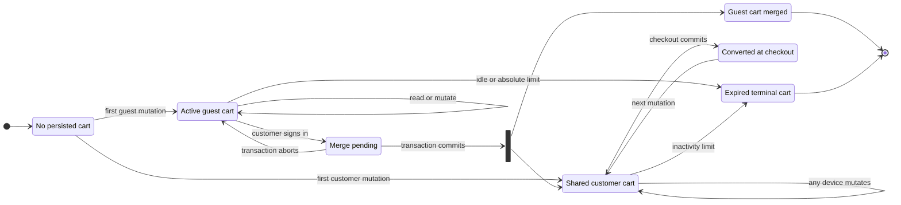

# ADR-0009 — Use server-side carts with hashed guest identity

- Status: Accepted
- Date: 2026-10-13
- Owners: Sara Kitchen engineering

## Context

Sara Kitchen must let an anonymous visitor build a cart before creating an account, preserve that cart
through navigation and browser restarts, merge it safely after sign-in, and present one coherent cart on
every authenticated device. A cart contains mutable quantities, delivery choices, notes, and calculated
totals, so trusting browser storage as the source of truth would enable price manipulation and make
concurrent updates or cross-device use unreliable.

Guest identity is a bearer credential even though it cannot authenticate an account: possession permits
reading and changing that guest cart. It therefore needs the same raw-token handling discipline as an
opaque session. Merge can touch an existing guest cart and an existing customer cart and must not duplicate
items when login or network requests retry.

## Decision

The Carts module owns server-side guest and customer carts. Exactly one active cart may exist for a guest
token digest and exactly one for a customer identifier. The browser never supplies trusted prices, totals,
availability, customer identity, or a database cart ID.

### Guest identity and browser storage

- Do not create a database cart or cookie while a visitor only browses. The first successful anonymous cart
  mutation creates both.
- Generate at least 256 bits of cryptographically secure random token material and encode it as base64url.
  Return the raw token only in an HTTP-only cookie and persist only its SHA-256 digest. Validate encoding and
  length before hashing or querying.
- Use `__Host-sk_guest_cart` in production with `Secure`, `HttpOnly`, `SameSite=Lax`, `Path=/`, no `Domain`,
  and a 30-day maximum age. Local HTTP development uses `sk_guest_cart`. Never store the token or cart
  identity in localStorage, sessionStorage, a URL, logs, analytics, or response JSON.
- Cookie authentication remains subject to the existing same-origin/CSRF policy. SameSite is defense in
  depth, not the only mutation protection.
- A guest cart has a 30-day sliding inactivity limit and a 90-day absolute lifetime. A successful read or
  mutation may refresh the idle deadline and cookie at most once per 24 hours. Reads enforce both deadlines;
  MongoDB TTL is cleanup only. Terminal guest carts receive a separate purge timestamp and are retained for
  30 days for operational diagnosis without retaining the raw token.

### Customer identity and multi-device behavior

- An authenticated cart is resolved exclusively from the validated customer session and its customer ID;
  no customer cart cookie or client cart ID is accepted.
- All sessions and devices for one customer share the same active server cart. Every mutation carries the
  last observed cart version. A stale version returns a conflict plus the fresh authoritative cart instead
  of silently overwriting another device.
- Customer carts expire after 180 days without activity. Expiry is application-enforced, transitions the
  cart to a terminal state, and assigns a 30-day purge timestamp. Checkout atomically marks the active cart
  converted; the next cart mutation creates a new active cart. Logout leaves the customer cart unchanged.
- After logout, anonymous additions use a newly generated guest identity. A customer cart is never copied
  back into a guest cart.

### Sign-in merge

The login route/application orchestrator calls the public Carts merge command after authentication succeeds;
the Auth module does not access Cart persistence. The command receives the validated customer identity and
the raw guest token from its cookie, then validates and hashes that token inside the server boundary.

The merge runs in one MongoDB transaction and is idempotent:

1. Load the active guest cart by digest and the customer's active cart, creating the customer cart if absent.
2. Combine equal dish lines by summing quantities and cap them at the dish's current maximum. Preserve the
   customer note when present; otherwise copy the guest note. Never copy a selected address from a guest cart.
3. Revalidate dish existence, availability, quantity, price, discount, and lead time from public domain APIs.
   Do not silently discard rejected or capped quantities: return bounded merge notices for review.
4. Recalculate all totals server-side, increment the customer cart version, mark the guest cart `merged` with
   the target customer-cart reference and purge timestamp, and commit together.
5. Clear the guest cookie only after commit. A retry finds the same `merged` marker and returns the already
   committed customer cart without adding quantities again.

Concurrent merges or customer mutations use unique active-identity indexes, optimistic versions, and bounded
transaction retry. No network/provider side effect occurs inside the transaction. If merge fails, sign-in
still succeeds, neither cart is partially changed, and the guest cookie remains so a subsequent authenticated
cart read can retry. The UI must surface a localized non-destructive merge warning rather than claiming the
guest items were imported.

### Approved lifecycle

The diagram is the approved lifecycle contract for SK-0137 through SK-0141. `NoCart` is a response state,
not a stored document. `MergePending` is a transaction boundary, not a durable cart status. Implementations
may use internal names, but observable transitions and failure behavior must remain equivalent.

## Alternatives considered

### Browser-only cart in localStorage

Rejected because it exposes mutable state to script access, cannot support authoritative pricing or reliable
multi-device behavior, and makes server checkout reconciliation unnecessarily complex.

### Raw guest token or database cart ID in a cookie

Rejected because a database disclosure would reveal reusable cart credentials, while a predictable cart ID
would enable horizontal access attempts. The raw opaque token exists only in the protected cookie.

### Separate authenticated cart per device

Rejected because customers would see inconsistent baskets, login merge behavior would depend on device, and
checkout conflicts would become harder to explain. One customer cart plus optimistic versioning gives a clear
source of truth.

### Guest cart always replaces the customer cart on login

Rejected because it can destroy a cart created on another device. Deterministic line merging preserves both
sources while current catalog rules remain authoritative.

### Make login fail when merge fails

Rejected because authentication and cart import have different failure domains. Preserving both carts and
retrying is safer than denying a valid login or performing a partial merge.

## Consequences

### Positive

- Prices, availability, ownership, and cart totals remain server-authoritative.
- Database disclosure does not directly reveal active guest bearer tokens.
- Authenticated users see one cart across tabs, sessions, and devices.
- Transactional, idempotent merge prevents partial imports and duplicate quantities.
- Lazy guest creation avoids unnecessary records and tracking cookies for simple visitors.

### Costs and risks

- Guest cart access requires a database lookup and secure cookie lifecycle handling.
- Merge requires a transaction-capable MongoDB topology; standalone development cannot exercise it faithfully.
- Shared carts create legitimate device conflicts that the UI must resolve from fresh server state.
- Retention, scheduled expiry, terminal cleanup, and merge notices add model and operational complexity.
- A stolen guest cookie permits cart access until expiry; HTTPS, HTTP-only cookies, token entropy, and bounded
  lifetime reduce but cannot eliminate that bearer-token risk.

## Revisit when

- Native mobile clients require a non-cookie guest credential transport.
- Collaborative/shared carts are introduced as a distinct product feature.
- Multi-region writes make one active customer cart or MongoDB transaction latency impractical.
- Legal or analytics requirements change cart retention periods.
- Authentication moves to a topology where post-login cart orchestration cannot access the original guest
  cookie safely.
