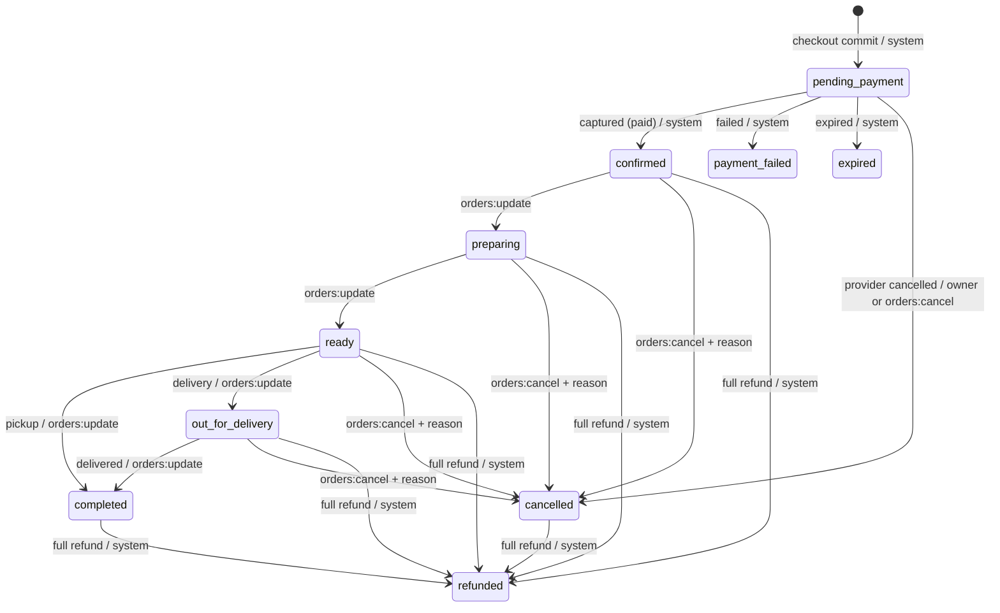

# Order state machine (SK-0153)

The Order status describes the **customer-visible fulfillment outcome**; the Transaction status remains the financial authority. The model starts at `pending_payment` and stores the Transaction state observed for each lifecycle event. `completed` means **collected** for pickup or **delivered** for delivery. A full refund becomes `refunded` while prior history preserves whether food was completed first. A partial refund keeps the fulfillment status and appends a system `payment_partial_refund` event at a new order revision.

`payment_failed`, `expired`, and `refunded` are terminal for this order. A failed/expired payment requires a new checkout/order rather than silently reviving an old financial record. The only same-status event is a verified partial refund recorded by the system; duplicate delivery with the same event key must not append another revision.

| Transition                                       | Actor and permission                                                                   | Required Transaction state     | Customer visibility / durable notification intent                                         | Sold-count effect                 |
| ------------------------------------------------ | -------------------------------------------------------------------------------------- | ------------------------------ | ----------------------------------------------------------------------------------------- | --------------------------------- |
| Create `pending_payment`                         | Checkout system                                                                        | `created` or `pending`         | Awaiting payment; enqueue employer WhatsApp `order_submitted`                             | None                              |
| `pending_payment` → `confirmed`                  | Payment system                                                                         | `paid` or `partially-refunded` | Confirmed; enqueue customer confirmation and employer paid notice                         | No sale yet                       |
| `pending_payment` → `payment_failed` / `expired` | Payment system                                                                         | Matching `failed` / `expired`  | Explain recoverable new-checkout action; enqueue customer notice                          | None                              |
| `pending_payment` → `cancelled`                  | Owning customer or admin with `orders:cancel`; system only after provider cancellation | `cancelled`                    | Cancelled; enqueue customer and employer notice                                           | None                              |
| `confirmed` → `preparing` → `ready`              | Active admin with `orders:update`                                                      | `paid` or `partially-refunded` | Show each stage; notify customer when ready                                               | None                              |
| `ready` → `out_for_delivery`                     | Active admin with `orders:update`; delivery only                                       | `paid` or `partially-refunded` | Out for delivery; enqueue customer notice                                                 | None                              |
| `ready` → `completed`                            | Active admin with `orders:update`; pickup only                                         | `paid` or `partially-refunded` | Collected; enqueue customer notice                                                        | Recompute: count qualifying units |
| `out_for_delivery` → `completed`                 | Active admin with `orders:update`; delivery only                                       | `paid` or `partially-refunded` | Delivered; enqueue customer notice                                                        | Recompute: count qualifying units |
| Paid active → `cancelled`                        | Active admin with `orders:cancel` and reason                                           | `paid` or `partially-refunded` | Cancelled, refund **pending manual phone-led handling**; enqueue customer/employer notice | Zero units                        |
| Paid active or `cancelled` → `refunded`          | Payment/reconciliation system                                                          | Fully `refunded`               | Refunded; enqueue customer/employer notice                                                | Recompute to zero                 |
| Same active status → same status                 | Payment/reconciliation system, `payment_partial_refund` reason                         | `partially-refunded`           | Keep fulfillment label; show separate payment details                                     | Recompute if already completed    |

“Paid active” means `confirmed`, `preparing`, `ready`, or `out_for_delivery`; `completed` can only progress to `refunded`, not to `cancelled`. Paid-order cancellation never invents a provider refund. `refundFollowUpRequired` flags the manual process. Full refunds are recorded only after the Transaction reaches `refunded`; phone calls themselves are external side effects. Customer cancellation requires ownership **and** a confirmed provider `cancelled` state, preventing an in-flight capture race.

The Orders service must resolve the actor from a verified session, verify active role/permission or customer ownership, and read the authoritative Transaction in the **same MongoDB transaction** that appends Order history and outbox work. The pure planner validates role/ownership and returns effects; the model replays the status graph, actor kind, fulfillment mode, and recorded payment evidence on both validation and save. The model cannot independently prove that the recorded payment status matches a separate Transaction document. SK-0154+ must make this cross-collection guarantee atomic. No provider call, WhatsApp send, or customer message is executed inside the retryable transaction callback; notification intents become durable outbox work and are sent after commit.

The sold-count adapter maps Order `completed` to fulfillment `completed`, `cancelled`/`refunded` to `cancelled`, and other statuses to `open`. Transaction `paid`, `partially-refunded`, and `refunded` map to the Dishes projector’s payment vocabulary; all others map to `unpaid`. A dish counts only when fulfillment is completed and payment is paid/partially refunded. Full refund removes all contribution; partial monetary goodwill refunds do not remove units unless item-level refunded quantities are explicitly recorded by a later refund workflow. Every qualifying change, including a completed order’s partial-payment sync, increments order revision and requests an idempotent projector update in the same database transaction. See `docs/dish-sold-count.md`.

`tests/unit/order-state-machine.test.ts` covers actor, payment, method, terminal, notification, and sold-count decisions. The Order model and persisted integration tests reject forged payment-coupled history even when save validation is bypassed.
